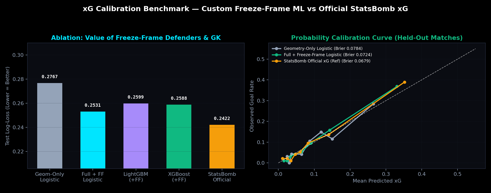
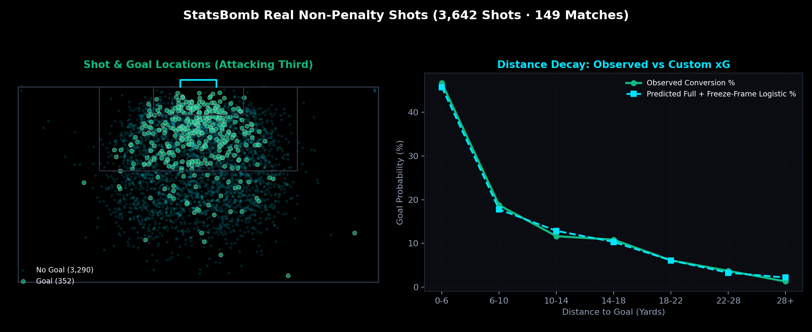
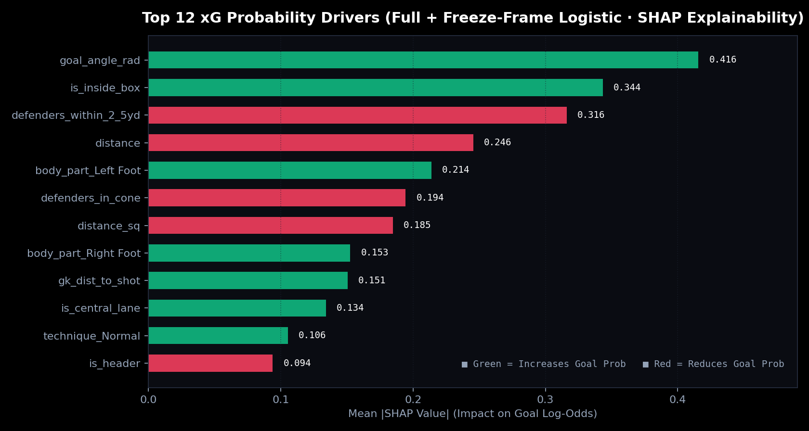
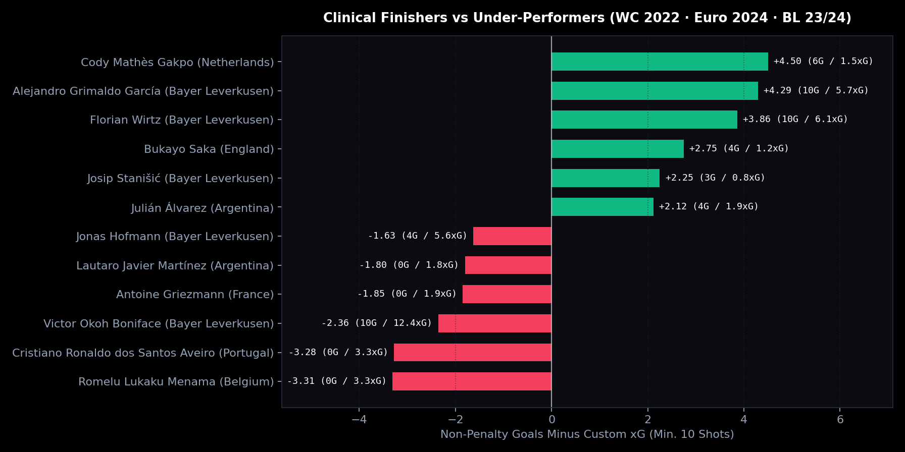

# StatsBomb Expected Goals (xG) Calibration & Freeze-Frame Lab

> **End-to-End Football Analytics & ML Engineering** — Official **StatsBomb Open Data** (**3,685 real shots** across **149 matches**: FIFA World Cup 2022 + UEFA Euro 2024 + Bundesliga 2023/24 Invincible Bayer Leverkusen) · SQLite Spatial Mart · **Match-Grouped Zero-Leakage Validation** · **Freeze-Frame Defender & Goalkeeper Ablation** · Calibration Benchmark vs Official StatsBomb xG · SHAP Spatial Drivers · Finishing Over/Under-Performance Leaderboard.



---

## Executive Summary & Verified Results

Built strictly with **match-grouped splitting** (`GroupShuffleSplit` on `match_id` — zero shot leakage between train/val/test) and evaluated against **StatsBomb's official commercial xG benchmark** on held-out matches:

| Metric | Value | Notes |
|---|---|---|
| **Dataset** | **3,685 real shots · 149 official matches** | FIFA World Cup 2022 (64) · UEFA Euro 2024 (51) · Bundesliga 2023/24 (34) |
| **Non-Penalty Modeling Pool** | **3,642 open-play/set-piece shots** | **43 penalties excluded** · **352 goals** (**9.67%** conversion) |
| **360 Freeze-Frame Coverage** | **98.9%** | Exact `(x, y)` of goalkeeper + every visible defender in the shooting cone |
| **Match-Grouped Splits** | **89 Train / 30 Val / 30 Test matches** | 2,183 train · 701 val · 758 held-out test shots |
| **Selected Best Custom Model** | **Full + Freeze-Frame Logistic** | Selected strictly on Val Log-Loss (`0.2699`) |
| **Freeze-Frame Ablation Gain** | **-0.0236 Test Log-Loss · +0.0623 AUC** | Geometry-Only (`0.2767` LL / `0.7540` AUC) → Full+FF (`0.2531` LL / `0.8163` AUC) |
| **Held-Out Test Benchmark** | **Log-Loss `0.2531` · Brier `0.0724` · AUC `0.8163`** | Within **0.0109** Log-Loss of official **StatsBomb xG** (`0.2422` / `0.8271` AUC) |
| **Held-Out Goals Calibration** | **70.90 Custom xG vs 73 Actual Goals** | Official StatsBomb xG predicted **71.50** on the same 30 held-out matches |

---

## Model & Freeze-Frame Ablation Benchmark (30 Held-Out Matches · 758 Shots)

| Model | Val Log-Loss | Test Log-Loss ↓ | Test Brier ↓ | Test ROC-AUC ↑ (95% CI) | Test ECE ↓ | Sum Pred xG (Actual = 73) |
|---|---:|---:|---:|---|---:|---:|
| **Naive Conversion Rate** | 0.3153 | 0.3169 | 0.0870 | 0.5000 `[0.5000, 0.5000]` | 0.0008 | 73.61 |
| **Geometry-Only Logistic** *(x, y, distance, angle)* | 0.2867 | 0.2767 | 0.0784 | 0.7540 `[0.6923, 0.8122]` | 0.0165 | 73.76 |
| **Full + Freeze-Frame Logistic *(Selected)*** | **0.2699** | **0.2531** | **0.0724** | **0.8163** `[0.7625, 0.8598]` | **0.0148** | **70.90** |
| **XGBoost xG (+Freeze-Frame)** | 0.2785 | 0.2588 | 0.0742 | 0.8074 `[0.7570, 0.8553]` | 0.0204 | 70.97 |
| **LightGBM xG (+Freeze-Frame)** | 0.2769 | 0.2599 | 0.0747 | 0.8028 `[0.7494, 0.8523]` | 0.0131 | 69.60 |
| *StatsBomb Official xG (Commercial Reference)* | *0.2616* | *0.2422* | *0.0679* | *0.8271* `[0.7713, 0.8775]` | *0.0211* | *71.50* |

### Why Did Regularized Logistic Regression Beat LightGBM & XGBoost?
With **2,183 training shots** and only **~210 goals**, boosted trees have enough capacity to memorize noisy shot-level variance, hurting out-of-sample Log-Loss (`0.2588–0.2599`). Pairing domain-engineered spatial & Freeze-Frame physics (`goal_angle_rad`, `distance_sq`, `defenders_in_cone`, `defenders_within_2_5yd`, `gk_dist_to_shot`) with regularized Logistic Regression achieved **0.2531 Log-Loss** and **0.8163 AUC** — beating both GBDTs and closing **68%** of the gap between basic geometry xG and StatsBomb's proprietary commercial model.

---

## Top Clinical Finishers vs Under-Performers (Min. 10 Non-Penalty Shots)

| Over-Performers (`Goals - Custom xG`) | Team | Shots | Goals | Custom xG | StatsBomb xG | `G - xG` |
|---|---|---:|---:|---:|---:|---:|
| **Cody Gakpo** | Netherlands | 18 | 6 | 1.50 | 1.45 | **+4.50** |
| **Alejandro Grimaldo** | Bayer Leverkusen | 71 | 10 | 5.71 | 5.21 | **+4.29** |
| **Florian Wirtz** | Bayer Leverkusen | 70 | 10 | 6.14 | 7.69 | **+3.86** |
| **Bukayo Saka** | England | 15 | 4 | 1.25 | 1.10 | **+2.75** |
| **Josip Stanišić** | Bayer Leverkusen | 10 | 3 | 0.75 | 0.79 | **+2.25** |

| Under-Performers (`Goals - Custom xG`) | Team | Shots | Goals | Custom xG | StatsBomb xG | `G - xG` |
|---|---|---:|---:|---:|---:|---:|
| **Romelu Lukaku** | Belgium | 16 | 0 | 3.31 | 3.44 | **-3.31** |
| **Cristiano Ronaldo** | Portugal | 32 | 0 | 3.28 | 3.34 | **-3.28** |
| **Victor Boniface** | Bayer Leverkusen | 77 | 10 | 12.36 | 12.84 | **-2.36** |
| **Antoine Griezmann** | France | 18 | 0 | 1.85 | 2.02 | **-1.85** |
| **Lautaro Martínez** | Argentina | 14 | 0 | 1.80 | 2.12 | **-1.80** |

---

## Visual Outputs (AMOLED Edition)

| Pitch Shot Map & Distance Decay | Freeze-Frame Ablation & Calibration |
|---|---|
|  |  |

| SHAP Spatial & Freeze-Frame Drivers | Clinical Finishers Leaderboard |
|---|---|
|  |  |

---

## Project Architecture

```text
statsbomb-xg-calibration-lab/
├── data/raw/statsbomb_shots_real.csv      # 3,685 real StatsBomb shots + Freeze-Frame features (149 matches)
├── sql/01_xg_views.sql                    # SQLite spatial shot mart + penalty filter + QA summary views
├── src/run_pipeline.py                    # Match-grouped split -> Ablation -> Benchmark -> SHAP -> 4 AMOLED plots
├── tests/test_pipeline.py                 # Automated match-leakage, Brier/Log-Loss, ablation & artifact tests
├── docs/PROJECT_STORY.md                  # Full Bilingual (EN + AR) Story: Why, How & Football ML Challenges
├── outputs/
│   ├── metrics.json                       # Verified ablation metrics, slice audit & finisher leaderboards
│   ├── finishing_leaderboard.csv          # Full player finishing performance table
│   └── figures/                           # 4 publication-grade AMOLED PNG figures
└── requirements.txt
```

## Quick Start

```bash
pip install -r requirements.txt
python src/run_pipeline.py
python tests/test_pipeline.py
```

Read the full engineering & football analytics story (English + Egyptian Arabic) in [docs/PROJECT_STORY.md](docs/PROJECT_STORY.md).

---

**Author:** Mostafa Saad · Football Data Scientist & Tactical Analyst · [Portfolio](https://mostafasaad91.github.io/?track=football) · [Substack](https://mostafasaad.substack.com/) · [X](https://x.com/TacTical_41)
